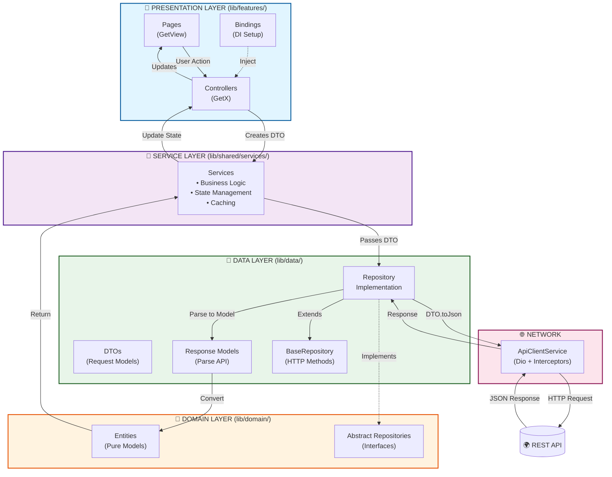

# Flutter Project Template

## Pre-requisites

### 1. Install Flutter Version Manager (FVM)

FVM helps maintain consistent Flutter SDK versions across your team. Install it using one of these methods:

#### Using Dart:

```bash
dart pub global activate fvm
```

#### Using curl (Linux/macOS):

```bash
curl -fsSL https://fvm.app/install.sh | sudo bash
```

After installation, add FVM to your PATH:

```bash
# For bash
echo 'export PATH="$PATH":"$HOME/.pub-cache/bin"' >> ~/.bashrc
source ~/.bashrc

# For zsh
echo 'export PATH="$PATH":"$HOME/.pub-cache/bin"' >> ~/.zshrc
source ~/.zshrc
```

### 2. Configure Flutter with FVM

This project uses Flutter 3.29.3. Set it up globally:

```bash
# Install Flutter 3.29.3 via FVM
fvm install 3.29.3

# Set as global default
fvm global 3.29.3
```

#### Verify installation:

```bash
fvm list
```

You should see Flutter 3.29.3 marked as global.

### 3. Install OpenJDK 17

Ensure OpenJDK 17 is installed for Android builds:

- Verify your JAVA_HOME environment variable is set correctly:

  ```bash
  echo $JAVA_HOME
  ```

- Configure Flutter to use JDK 17:

  ```bash
  fvm flutter config --jdk-dir=$JAVA_HOME
  ```

- Restart IDE & Terminal for these changes to take effect

## Setup Project

After forking this repository:

1. Navigate to your project directory

2. **Configure your app identity** (IMPORTANT - Do this first!):

   ```bash
   # Edit the config file
   nano scripts/app_config.json
   
   # Run the configuration script
   ./scripts/configure_app.sh
   ```

   See "App Configuration" section below for details.

3. Initialize FVM for the project:

   ```bash
   fvm use 3.29.3
   ```

   This creates a `.fvm` directory and links to the correct Flutter version.

4. Install dependencies:

   ```bash
   fvm flutter pub get
   
   # For iOS
   cd ios && pod install && cd ..
   ```

## App Configuration

### Configure App Name and Package/Bundle IDs

Before starting development, configure your app's identity:

1. **Edit the configuration file**:

   ```bash
   nano scripts/app_config.json
   ```

2. **Update with your app details**:

   ```json
   {
     "appName": {
       "development": "My App Dev",
       "staging": "My App Stg",
       "production": "My App"
     },
     "android": {
       "packageName": "com.mycompany.myapp"
     },
     "ios": {
       "bundleId": {
         "development": "com.mycompany.myapp.dev",
         "staging": "com.mycompany.myapp.stg",
         "production": "com.mycompany.myapp"
       }
     }
   }
   ```

   ⚠️ **IMPORTANT**: Package names and bundle IDs **MUST be lowercase**. Use format: `com.company.appname`

3. **Run the configuration script**:

   ```bash
   ./scripts/configure_app.sh
   ```

   This will update:
   - Android package name and app names for all flavors
   - iOS bundle identifiers and display names for all flavors
   - MainActivity.kt location and package declaration
   - Firebase configuration script bundle IDs (if flutterfire.config.sh exists)

4. **Clean and install dependencies**:

   ```bash
   fvm flutter clean
   cd ios && pod install && cd ..
   fvm flutter pub get
   ```

5. **Test your app**:

   ```bash
   make dev  # or fvm flutter run --flavor development
   ```

### Quick Fix for Package Issues

If you encounter `ClassNotFoundException: MainActivity` errors:

```bash
./scripts/configure_app.sh --fix
```

This quickly fixes Android package mismatches without changing other settings.

### Script Options

```bash
# Full configuration (requires jq)
./scripts/configure_app.sh

# Quick package fix only (no dependencies)
./scripts/configure_app.sh --fix

# Use custom config file
./scripts/configure_app.sh --config my-config.json

# Show help
./scripts/configure_app.sh --help
```

**Prerequisites for full mode**: Install `jq`
- Ubuntu/Debian: `sudo apt-get install jq`
- macOS: `brew install jq`

## Environment Configuration

- Define `BASE_URL` in `.env.development`, `.env.staging`, and `.env.production`. The template files are committed with example values—update them per environment.
- Validate an env file before builds with `dart run scripts/validate_env.dart <env-file>` (defaults to `.env.development`).
- The app loads the env file at startup based on `APP_ENV` (`development` by default). For other environments run, e.g., `fvm flutter run --dart-define=APP_ENV=staging`.
- `EnvConfigService` exposes the typed values to the rest of the app; see `env-config.md` for the full workflow.

## Regenerating Platform Files

Our repository tracks only essential configuration files. If you need to regenerate platform-specific files after cloning:

### Regenerate All Platform Files

```bash
# From project root
fvm flutter create --platforms=android,ios .
```

### Android-specific Regeneration

If you encounter issues with Android build:

```bash
# From project root
cd android
./gradlew clean
cd ..
fvm flutter pub get
```

### iOS-specific Regeneration

For iOS development, you may need to resolve CocoaPods issues:

```bash
# From project root
cd ios
pod deintegrate  # Removes all pods from the Xcode project
pod setup        # Sets up the CocoaPods master repo
pod install      # Reinstalls all pods
cd ..
```

If you encounter conflicts or outdated pods:

```bash
# Clean approach
cd ios
rm -rf Pods/
rm -rf Podfile.lock
pod install --repo-update
cd ..
```

## IDE Setup

### VS Code

FVM will automatically update your VS Code settings to use the correct Flutter SDK.

### Android Studio

In Preferences, set the Flutter SDK path to:

```
<project_path>/.fvm/flutter_sdk
```

## Project Conventions

### Folder Structure

Each feature should have its own directory with:

1. `Widgets`: Feature-specific widgets (avoid StatefulWidget when possible)
2. `Pages`: Screens for the feature
3. `Controllers`: GetXControllers associated with each page

### GetX Controllers

- Every page should have its own controller to manage state and dependencies

## Tests

Write unit tests for all helper functions:

```bash
# Run unit tests
fvm flutter test
```

## Development

### Run in Development Mode

```bash
fvm flutter run
```

### Build for Production

```bash
fvm flutter build apk
```

## Commit Convention

Format: `subject(ticket-code): message`

Valid subjects:
`build, chore, ci, docs, feat, fix, perf, refactor, revert, style, test`

## FVM Configuration

This project uses the following FVM configuration:

```json
{
  "flutter": "3.29.3",
  "useGitCache": true,
  "updateVscodeSettings": true,
  "updateGitIgnore": true,
  "runPubGetOnSdkChanges": true,
  "flavors": {
    "development": "3.29.3",
    "production": "3.29.3"
  }
}
```

This ensures everyone on the team uses the same Flutter version and configuration.

## Firebase Setup (Optional)

If your app uses Firebase, follow these steps to configure it for all environments.

### Prerequisites

1. Install FlutterFire CLI:

   ```bash
   dart pub global activate flutterfire_cli
   ```

2. Create Firebase projects for each environment:
   - Development: `myapp-dev`
   - Staging: `myapp-staging`
   - Production: `myapp-prod`

### Verify Bundle IDs in Firebase Script

**✅ Bundle IDs are automatically updated!**

If you ran `./scripts/configure_app.sh`, your bundle IDs in `flutterfire.config.sh` have been automatically updated to match your `scripts/app_config.json`. 

You can verify by checking `flutterfire.config.sh`:

```bash
# Development (line 30-32)
--ios-bundle-id=<your-ios-bundle-dev>
--android-package-name=<your-android-package>.dev

# Staging (line 41-43)
--ios-bundle-id=<your-ios-bundle-stg>
--android-package-name=<your-android-package>.stg

# Production (line 52-54)
--ios-bundle-id=<your-ios-bundle-prod>
--android-package-name=<your-android-package>
```

**Note:** Android Firebase uses flavor suffixes (`.dev`, `.stg`) while iOS can use custom bundle IDs per flavor as defined in your config.

### Run Firebase Configuration

Run the script for each environment:

```bash
# Make script executable
chmod +x flutterfire.config.sh

# Configure development
./flutterfire.config.sh development your-firebase-dev-project-id

# Configure staging
./flutterfire.config.sh staging your-firebase-staging-project-id

# Configure production
./flutterfire.config.sh production your-firebase-prod-project-id
```

This will create:
- `lib/firebase_options_development.dart`
- `lib/firebase_options_staging.dart`
- `lib/firebase_options_production.dart`
- `android/app/src/development/google-services.json`
- `android/app/src/staging/google-services.json`
- `android/app/src/production/google-services.json`
- `ios/flavors/development/GoogleService-Info.plist`
- `ios/flavors/staging/GoogleService-Info.plist`
- `ios/flavors/production/GoogleService-Info.plist`

### Update Main Entry Points

After generating Firebase options, update your main files to pass Firebase options to `runMainApp`:

**lib/main_development.dart:**
```dart
import 'package:flutter_getx_starter_template/firebase_options_development.dart';
import 'package:flutter_getx_starter_template/main.dart';
import 'package:flutter_getx_starter_template/utils/constants/enums.dart';

void main() async {
  await runMainApp(
    DefaultFirebaseOptions.currentPlatform,
    '.env.development',
    EEnvironmentType.development,
  );
}
```

**lib/main_staging.dart:**
```dart
import 'package:flutter_getx_starter_template/firebase_options_staging.dart';
import 'package:flutter_getx_starter_template/main.dart';
import 'package:flutter_getx_starter_template/utils/constants/enums.dart';

void main() async {
  await runMainApp(
    DefaultFirebaseOptions.currentPlatform,
    '.env.staging',
    EEnvironmentType.staging,
  );
}
```

**lib/main_production.dart:**
```dart
import 'package:flutter_getx_starter_template/firebase_options_production.dart';
import 'package:flutter_getx_starter_template/main.dart';
import 'package:flutter_getx_starter_template/utils/constants/enums.dart';

void main() async {
  await runMainApp(
    DefaultFirebaseOptions.currentPlatform,
    '.env.production',
    EEnvironmentType.production,
  );
}
```

**Update lib/main.dart:**

Modify your `runMainApp` function to accept Firebase options and initialize Firebase:

```dart
import 'package:firebase_core/firebase_core.dart';
import 'package:flutter/material.dart';
// ... other imports

Future<void> runMainApp(
  FirebaseOptions? firebaseOptions,  // Add this parameter
  String envFile,
  EEnvironmentType environment,
) async {
  WidgetsFlutterBinding.ensureInitialized();
  
  // Initialize Firebase if options are provided
  if (firebaseOptions != null) {
    await Firebase.initializeApp(options: firebaseOptions);
  }
  
  // Load environment variables
  await dotenv.load(fileName: envFile);
  
  // ... rest of your initialization
  
  runApp(MyApp());
}
```

This approach keeps Firebase initialization logic in one place and makes the main entry files cleaner!

### Environment Variables (Optional)

If you need Firebase-specific environment variables, add them to your `.env.*` files:

```bash
# .env.development
BASE_URL=https://api.dev.example.com

# .env.staging
BASE_URL=https://api.staging.example.com

# .env.production
BASE_URL=https://api.example.com
```

If you add new required environment variables, update `scripts/env_keys.dart`:

```dart
const requiredEnvKeys = [
  'BASE_URL',
  // Add any new required keys here
];
```

### iOS Additional Configuration

For iOS, you need to update the Xcode project to use the correct GoogleService-Info.plist for each flavor:

1. Open `ios/Runner.xcodeproj` in Xcode
2. In Build Phases, add a "Copy Files" phase before "Compile Sources"
3. Add a script to copy the correct plist based on flavor:

```bash
# In Xcode: Runner Target → Build Phases → + → New Run Script Phase
# Name it: "Copy GoogleService-Info.plist"
# Add this script:

PLIST_SOURCE="${PROJECT_DIR}/flavors/${CONFIGURATION}/GoogleService-Info.plist"
PLIST_DESTINATION="${BUILT_PRODUCTS_DIR}/${PRODUCT_NAME}.app/GoogleService-Info.plist"

if [ -f "$PLIST_SOURCE" ]; then
    cp "$PLIST_SOURCE" "$PLIST_DESTINATION"
    echo "Copied GoogleService-Info.plist for ${CONFIGURATION}"
else
    echo "Warning: GoogleService-Info.plist not found at $PLIST_SOURCE"
fi
```

### Verify Firebase Setup

Test each environment:

```bash
# Test development
make dev

# Test staging
./build.sh .env.staging run

# Test production
./build.sh .env.production run
```

### Troubleshooting

**"FirebaseOptions cannot be null"**
- Ensure you've run `flutterfire.config.sh` for the environment
- Check that firebase_options_*.dart files exist
- Verify the correct import in your main files

**"GoogleService-Info.plist not found" (iOS)**
- Verify the Copy Files script in Xcode Build Phases
- Check that files exist in `ios/flavors/*/GoogleService-Info.plist`
- Ensure the CONFIGURATION variable matches your flavor names

**"google-services.json not found" (Android)**
- Verify files exist in `android/app/src/*/google-services.json`
- Run `flutter clean` and rebuild

**Bundle ID mismatch**
- Ensure bundle IDs in `flutterfire.config.sh` match `scripts/app_config.json`
- Re-run both `./scripts/configure_app.sh` and `./flutterfire.config.sh`

---

## 📝 Firebase Setup Summary

### Files You Need to Change:

**1. lib/main.dart** (one-time change)
   - Add `FirebaseOptions?` as first parameter to `runMainApp`
   - Add Firebase initialization inside `runMainApp`
   ```dart
   Future<void> runMainApp(
     FirebaseOptions? firebaseOptions,  // ADD THIS
     String envFile,
     EEnvironmentType environment,
   ) async {
     WidgetsFlutterBinding.ensureInitialized();
     
     if (firebaseOptions != null) {
       await Firebase.initializeApp(options: firebaseOptions);
     }
     // ... rest of your code
   }
   ```

**2. lib/main_development.dart**
   ```dart
   import 'package:your_app/firebase_options_development.dart';
   
   void main() async {
     await runMainApp(
       DefaultFirebaseOptions.currentPlatform,  // ADD THIS
       '.env.development',
       EEnvironmentType.development,
     );
   }
   ```

**3. lib/main_staging.dart**
   ```dart
   import 'package:your_app/firebase_options_staging.dart';
   
   void main() async {
     await runMainApp(
       DefaultFirebaseOptions.currentPlatform,  // ADD THIS
       '.env.staging',
       EEnvironmentType.staging,
     );
   }
   ```

**4. lib/main_production.dart**
   ```dart
   import 'package:your_app/firebase_options_production.dart';
   
   void main() async {
     await runMainApp(
       DefaultFirebaseOptions.currentPlatform,  // ADD THIS
       '.env.production',
       EEnvironmentType.production,
     );
   }
   ```

### Optional: Environment Variables

**If you need additional environment variables:**

**5. Add to .env files:**
   ```bash
   # .env.development
   BASE_URL=https://api.dev.example.com
   # Add any environment-specific variables here
   
   # .env.staging
   BASE_URL=https://api.staging.example.com
   # Add any environment-specific variables here
   
   # .env.production
   BASE_URL=https://api.example.com
   # Add any environment-specific variables here
   ```

**6. Update scripts/env_keys.dart** (if adding required keys):
   ```dart
   const requiredEnvKeys = [
     'BASE_URL',
     // Add new required keys here
   ];
   ```

---

## 📁 Feature Folder Structure

Each feature follows a consistent GetX architecture pattern:

```
lib/features/
├── feature-name/
│   ├── bindings/
│   │   └── feature_binding.dart
│   ├── controllers/
│   │   └── feature_controller.dart
│   ├── pages/
│   │   └── feature_page.dart
│   └── widgets/
│       └── feature_widgets.dart
```

### Adding a New Feature with Bindings

**1. Create the Controller:**
```dart
// lib/features/feature-name/controllers/feature_controller.dart
import 'package:get/get.dart';

class FeatureController extends GetxController {
  static FeatureController get instance => Get.find();
  
  // Your controller logic here
}
```

**2. Create the Binding:**
```dart
// lib/features/feature-name/bindings/feature_binding.dart
import 'package:get/get.dart';
import '../controllers/feature_controller.dart';

class FeatureBinding extends Bindings {
  @override
  void dependencies() {
    Get.lazyPut<FeatureController>(() => FeatureController());
  }
}
```

**3. Create the Page using GetView:**
```dart
// lib/features/feature-name/pages/feature_page.dart
import 'package:flutter/material.dart';
import 'package:get/get.dart';
import '../controllers/feature_controller.dart';

class FeaturePage extends GetView<FeatureController> {
  const FeaturePage({super.key});

  @override
  Widget build(BuildContext context) {
    return Scaffold(
      body: Center(
        child: Text('Feature Page'),
      ),
    );
  }
}
```

**4. Register in Routes:**
```dart
// lib/routes.dart
GetPage(
  name: Routes.feature,
  page: () => const FeaturePage(),
  binding: FeatureBinding(),
),
```

**Benefits:**
- ✅ Automatic controller lifecycle management
- ✅ Lazy loading - controllers only instantiated when needed
- ✅ Clean dependency injection
- ✅ Easy access to controller via `controller` property in GetView

---

## 🏗️ Architecture Overview

This project follows **Clean Architecture** principles with a pragmatic approach, ensuring maintainability, testability, and separation of concerns.

### Tool 
Recomended tool for model creation from json **[Quick Type](https://app.quicktype.io/)**

### Architecture Layers



### Layer Responsibilities

**🎨 Presentation Layer** (`lib/features/`)
- Pages (UI widgets using GetView)
- Controllers (State management, user interactions)
- Bindings (Dependency injection setup)
- Creates DTOs and passes to services

**🔧 Service Layer** (`lib/shared/services/`)
- Business logic orchestration
- State management (observable data)
- Coordinates multiple repositories
- Caching and data transformations

**🎯 Domain Layer** (`lib/domain/`)
- **Entities**: Pure business models (no external dependencies)
- **Abstract Repositories**: Contracts/interfaces for data operations
- Core business rules and logic

**💾 Data Layer** (`lib/data/`)
- **DTOs**: Data Transfer Objects for API requests
- **Response Models**: Parse API responses and convert to entities
- **Repository Implementations**: Execute actual data operations
- Handles API communication via BaseRepository

---

## 📝 Naming Conventions

### Files & Folders

```
✅ CORRECT                          ❌ WRONG
────────────────────────────────────────────────────────
user_profile.dart                   UserProfile.dart
product_service.dart                ProductService.dart
create_product_dto.dart             CreateProductDTO.dart
product_details/                    ProductDetails/ or product-details/
user_profiles/                      UserProfiles/ or user-profiles/
```

**Rules:**
- Use `snake_case` for all file and folder names
- Use `snake_case` for multi-word folders (e.g., `user_profiles/`, `product_details/`)
- Suffix with type: `_controller.dart`, `_service.dart`, `_dto.dart`

### Classes

```dart
// Entities (Domain Layer)
class ProductEntity { }           // Suffix: Entity

// Abstract Repositories (Domain Layer)
abstract class AbstractProductRepository { }  // Prefix: Abstract

// DTOs (Data Layer)
class CreateProductDto { }        // Suffix: Dto
class UpdateProductDto { }

// Response Models (Data Layer)
class ProductResponseModel { }    // Suffix: ResponseModel

// Repository Implementation (Data Layer)
class ProductRepository extends BaseRepository 
    implements AbstractProductRepository { }  // Suffix: Repository

// Services (Service Layer)
class ProductService extends GetxService { }  // Suffix: Service

// Controllers (Presentation Layer)
class ProductsController extends GetxController { }  // Suffix: Controller

// Pages (Presentation Layer)
class ProductsPage extends GetView<ProductsController> { }  // Suffix: Page

// Bindings (Presentation Layer)
class ProductsBinding extends Bindings { }    // Suffix: Binding
```

### Variables & Methods

```dart
// Observable variables
final RxList<ProductEntity> products = <ProductEntity>[].obs;
final RxBool isLoading = false.obs;
final Rx<ProductEntity?> selectedProduct = Rx<ProductEntity?>(null);

// Private variables
final AbstractProductRepository _repository = ProductRepository();
final ProductService _productService = ProductService.instance;

// Methods
Future<void> fetchProducts() async { }
Future<ProductEntity> getProduct(String id) async { }
Future<ProductEntity> createProduct(CreateProductDto dto) async { }
```

**Rules:**
- Use `camelCase` for variables and methods
- Prefix private members with underscore: `_repository`, `_service`
- Observable variables should clearly indicate their type
- Use descriptive names: `fetchProducts()` not `fetch()`

### Constants

```dart
// Routes
class Routes {
  static const String home = '/home';
  static const String products = '/products';
  static const String productDetail = '/product-detail';
}

// API Endpoints
class ApiEndpoints {
  static String products = '$_baseUrl/products';
  static String productById(String id) => '$_baseUrl/products/$id';
}
```

---

## 🔄 Data Flow Example

Here's how data flows through the architecture when creating a product:

```dart
// 1️⃣ USER INTERACTION (Page)
// User fills form and clicks "Create"
ElevatedButton(
  onPressed: () => controller.createProduct(
    name: nameController.text,
    description: descController.text,
    price: double.parse(priceController.text),
    stock: int.parse(stockController.text),
  ),
)

// 2️⃣ CONTROLLER (Presentation Layer)
Future<void> createProduct({
  required String name,
  required String description,
  required double price,
  required int stock,
}) async {
  // Create DTO from user input
  final dto = CreateProductDto(
    name: name,
    description: description,
    price: price,
    stock: stock,
  );
  
  // Pass to service
  await _productService.createProduct(dto);
}

// 3️⃣ SERVICE (Service Layer)
Future<ProductEntity> createProduct(CreateProductDto dto) async {
  isLoading.value = true;
  
  // Call repository with DTO
  final newProduct = await _repository.createProduct(dto);
  
  // Update local state
  products.add(newProduct);
  
  return newProduct;
}

// 4️⃣ REPOSITORY (Data Layer)
Future<ProductEntity> createProduct(CreateProductDto createProductDto) async {
  // Make HTTP POST request
  final response = await postRequest(
    ApiEndpoints.products,
    createProductDto.toJson(),  // DTO → JSON
  );
  
  // Parse response → Model → Entity
  final model = ProductResponseModel.fromJson(response.body);
  return model.toEntity();  // Convert to domain entity
}

// 5️⃣ RESPONSE FLOW
// Entity → Service → Controller → Page (UI updates via Obx)
```

---

## 🎯 Current Setup Explained

### What Is What?

**📦 Entity (Domain)**
```dart
// Pure business model - no dependencies
class ProductEntity {
  final String id;
  final String name;
  final double price;
  
  // Business logic
  bool get isInStock => stock > 0;
}
```
- Lives in `lib/domain/entitys/`
- Represents core business concepts
- No external dependencies (no JSON parsing, no HTTP)
- Can contain business logic methods

**📋 DTO - Data Transfer Object (Data)**
```dart
// Structure for API requests
class CreateProductDto {
  final String name;
  final double price;
  
  Map<String, dynamic> toJson() => {
    'name': name,
    'price': price,
  };
}
```
- Lives in `lib/data/dto_models/`
- Defines what we SEND to the API
- Only includes fields needed for the request
- Has `toJson()` method

**📥 Response Model (Data)**
```dart
// Parses API responses
class ProductResponseModel {
  final String id;
  final String name;
  
  factory ProductResponseModel.fromJson(Map<String, dynamic> json) {
    return ProductResponseModel(
      id: json['id'],
      name: json['name'],
    );
  }
  
  // Converts API response to domain entity
  ProductEntity toEntity() {
    return ProductEntity(id: id, name: name);
  }
}
```
- Lives in `lib/data/response_model/`
- Parses what we RECEIVE from API
- Has `fromJson()` factory
- Has `toEntity()` to convert to domain model

**📜 Abstract Repository (Domain)**
```dart
// Contract/Interface
abstract class AbstractProductRepository {
  Future<ProductEntity> createProduct(CreateProductDto dto);
  Future<List<ProductEntity>> getAllProducts();
}
```
- Lives in `lib/domain/abstract_repositories/`
- Defines WHAT operations are available
- No implementation details
- Domain layer depends on this, not the implementation

**🔨 Repository Implementation (Data)**
```dart
// Actual implementation
class ProductRepository extends BaseRepository 
    implements AbstractProductRepository {
  @override
  Future<ProductEntity> createProduct(CreateProductDto dto) async {
    final response = await postRequest(endpoint, dto.toJson());
    return ProductResponseModel.fromJson(response.body).toEntity();
  }
}
```
- Lives in `lib/data/repositories/`
- Implements the abstract repository
- Extends `BaseRepository` for HTTP methods
- Handles API communication and data transformation

**🎯 Service (Service Layer)**
```dart
class ProductService extends GetxService {
  final AbstractProductRepository _repository;  // Uses abstraction
  final RxList<ProductEntity> products = <ProductEntity>[].obs;
  
  Future<ProductEntity> createProduct(CreateProductDto dto) async {
    final product = await _repository.createProduct(dto);
    products.add(product);  // Update state
    return product;
  }
}
```
- Lives in `lib/shared/services/`
- Orchestrates business logic
- Manages observable state
- Can coordinate multiple repositories
- UI-agnostic (doesn't know about widgets)

---

## 🔀 When to Use Use Cases

### Current Setup (Simple Projects)
```
Controller → Service → Repository → API
```
For most features, services are sufficient. They handle business logic and state management.

### With Use Cases (Complex Projects)

Use cases should be added when you have:
- Complex business logic that involves multiple steps
- Operations that coordinate multiple repositories
- Reusable business operations across different features
- Need for better testability of business logic

```
Controller → Service → Use Cases → Repositories → API
```

### Use Case Example

**Create Use Case:**
```dart
// lib/domain/use_cases/create_product_use_case.dart
class CreateProductUseCase {
  final AbstractProductRepository _productRepository;
  final AbstractInventoryRepository _inventoryRepository;
  final AbstractNotificationRepository _notificationRepository;
  
  CreateProductUseCase(
    this._productRepository,
    this._inventoryRepository,
    this._notificationRepository,
  );
  
  Future<ProductEntity> execute(CreateProductDto dto) async {
    // 1. Validate business rules
    if (dto.price < 0) {
      throw Exception('Price cannot be negative');
    }
    
    // 2. Create product
    final product = await _productRepository.createProduct(dto);
    
    // 3. Update inventory
    await _inventoryRepository.addStock(product.id, dto.stock);
    
    // 4. Send notification
    await _notificationRepository.notifyNewProduct(product);
    
    return product;
  }
}
```

**Service Consuming Use Cases:**
```dart
class ProductService extends GetxService {
  final CreateProductUseCase _createProductUseCase;
  final GetProductsUseCase _getProductsUseCase;
  final DeleteProductUseCase _deleteProductUseCase;
  
  final RxList<ProductEntity> products = <ProductEntity>[].obs;
  
  Future<ProductEntity> createProduct(CreateProductDto dto) async {
    try {
      isLoading.value = true;
      
      // Use case handles complex logic
      final product = await _createProductUseCase.execute(dto);
      
      // Service handles state management
      products.add(product);
      
      return product;
    } finally {
      isLoading.value = false;
    }
  }
  
  Future<void> fetchProducts() async {
    final fetchedProducts = await _getProductsUseCase.execute();
    products.value = fetchedProducts;
  }
}
```

**Folder Structure with Use Cases:**
```
lib/
├── domain/
│   ├── entitys/
│   │   └── product_entity.dart
│   ├── abstract_repositories/
│   │   ├── abstract_product_repository.dart
│   │   └── abstract_inventory_repository.dart
│   └── use_cases/                           ⬅️ NEW
│       ├── create_product_use_case.dart
│       ├── get_products_use_case.dart
│       └── delete_product_use_case.dart
├── data/
├── shared/
│   └── services/
│       └── product.service.dart             ⬅️ Consumes use cases
└── features/
```

**When NOT to Use Use Cases:**
- Simple CRUD operations (current setup is sufficient)
- Operations that only touch one repository
- Projects with limited complexity
- When services alone provide enough abstraction

**When to USE Use Cases:**
- Operations involving multiple repositories
- Complex business rules and validation
- Reusable business logic across features
- When you need to test business logic independently
- Large-scale applications with many features

---

## 🧪 Example: Product Feature

This template includes a **complete working example** of the architecture with a Product feature demonstrating:
- ✅ GET request (fetch products)
- ✅ POST request (create product)
- ✅ PATCH request (update product)
- ✅ DELETE request (delete product)

**Example Files:**
```
lib/
├── domain/
│   ├── entitys/product_entity.dart
│   └── abstract_repositories/abstract_product_repository.dart
├── data/
│   ├── dto_models/
│   │   ├── create_product_dto.dart
│   │   └── update_product_dto.dart
│   ├── response_model/product_response_model.dart
│   └── repositories/product_repository.dart
├── shared/services/product.service.dart
└── features/products/
    ├── controllers/products_controller.dart
    ├── pages/products_page.dart
    └── bindings/products_binding.dart
```

**📌 Note:** The Product example is for **learning purposes**. Once you're comfortable with the architecture, feel free to:
- Remove the entire `features/products/` folder
- Delete `product.service.dart`
- Remove product-related files from `domain/` and `data/`
- Delete product endpoints from `api_endpoints.dart`

Then build your own features following the same pattern!

---

## 🚀 Quick Start Checklist

- [ ] Configure app identity with `./scripts/configure_app.sh`
- [ ] Update environment variables in `.env.*` files
- [ ] Review the Product example to understand architecture
- [ ] Create your first feature following the structure
- [ ] Register services in `global_bindings.dart`
- [ ] Add routes in `routes.dart`
- [ ] Remove Product example when comfortable
- [ ] Write tests for your features

---

## Adopt this template for your product

Use these steps when starting a new app from this repo. Flavors are already wired as `development`, `staging`, and `production` — you mainly rename IDs and display names.

### 1. Set your app identity

Edit `scripts/app_config.json`:

```json
{
  "appName": {
    "development": "MyApp Dev",
    "staging": "MyApp Staging",
    "production": "MyApp"
  },
  "android": {
    "packageName": "com.company.myapp"
  },
  "ios": {
    "bundleId": {
      "development": "com.company.myapp.dev",
      "staging": "com.company.myapp.stg",
      "production": "com.company.myapp"
    }
  }
}
```

Then apply it:

```bash
./scripts/configure_app.sh
```

This updates Android package / app names, iOS bundle IDs / display names (`APP_NAME`), and `flutterfire.config.sh`.

### 2. Fill environment files

```bash
cp .env.example .env.development
cp .env.example .env.staging
cp .env.example .env.production
```

Set at least:

| Key | Purpose |
|---|---|
| `BASE_URL` | API base URL per environment |
| `APP_NAME` | Display name used by Dart (`AppConfig`) |

Keep `.env.*` out of git (already gitignored).

### 3. Match Dart display names (optional but recommended)

Update the `appName:` strings in:

- `lib/main_development.dart`
- `lib/main_staging.dart`
- `lib/main_production.dart`

so they match the names in `app_config.json`.

### 4. Firebase (only if you need it)

1. Create Firebase apps for each package / bundle ID (`.dev`, `.stg`, production).
2. Run once per flavor:

```bash
./flutterfire.config.sh development <firebase-project-id>
./flutterfire.config.sh staging <firebase-project-id>
./flutterfire.config.sh production <firebase-project-id>
```

3. Uncomment the `firebase_options_*` import + `firebaseOptions:` line in each `lib/main_<flavor>.dart`.

### 5. Install & run

```bash
fvm flutter pub get
cd ios && pod install && cd ..

make development   # or: make staging / make production
```

IDE: use the **Flutter Template (development / staging / production)** launch configs (they pass `--flavor` + the matching `-t` entrypoint).

### 6. What you usually do not change

These are already set up for the three flavors:

- Android `productFlavors` (`.dev` / `.stg` suffixes)
- iOS configs: `Debug|Profile|Release-<flavor>`
- iOS schemes: `development`, `staging`, `production`
- Entrypoints: `lib/main_<flavor>.dart`
- Env loading via `AppConfig` (no `--dart-define` for flavor)

Only touch those if you are adding a **new** flavor, not renaming for a new product.

### Checklist

- [ ] Updated `scripts/app_config.json` and ran `./scripts/configure_app.sh`
- [ ] Created / filled `.env.development`, `.env.staging`, `.env.production`
- [ ] Updated `appName` in `main_*.dart` if needed
- [ ] (Optional) Ran FlutterFire and enabled Firebase in entrypoints
- [ ] `pod install` + `make development` succeeds
- [ ] Three apps install side-by-side with different IDs / names

